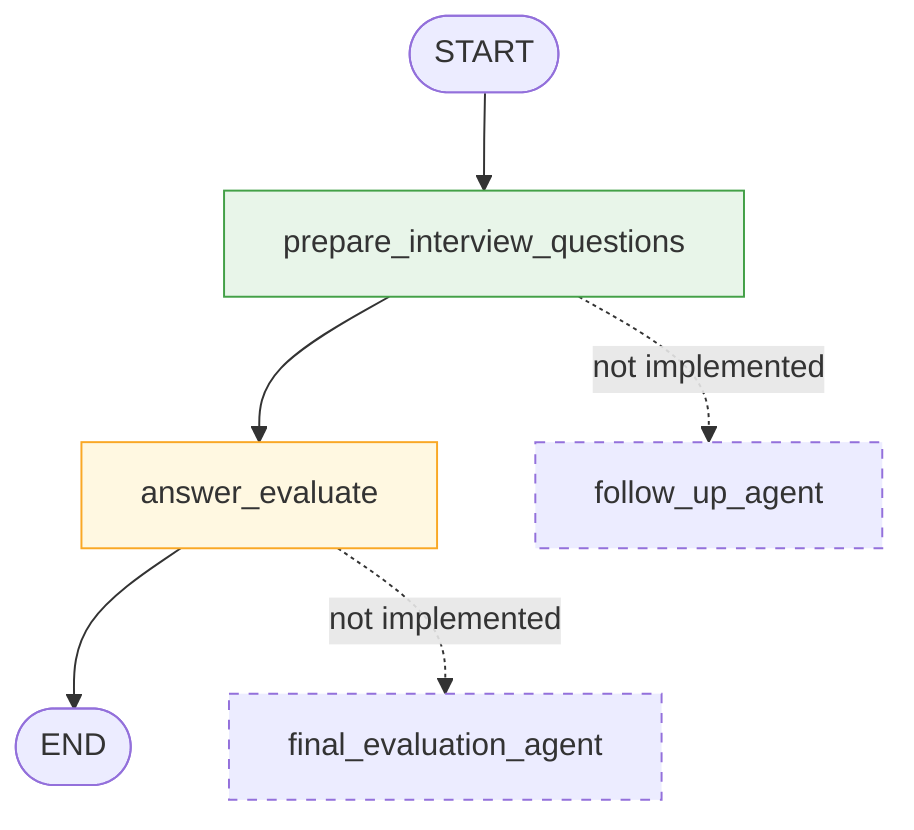
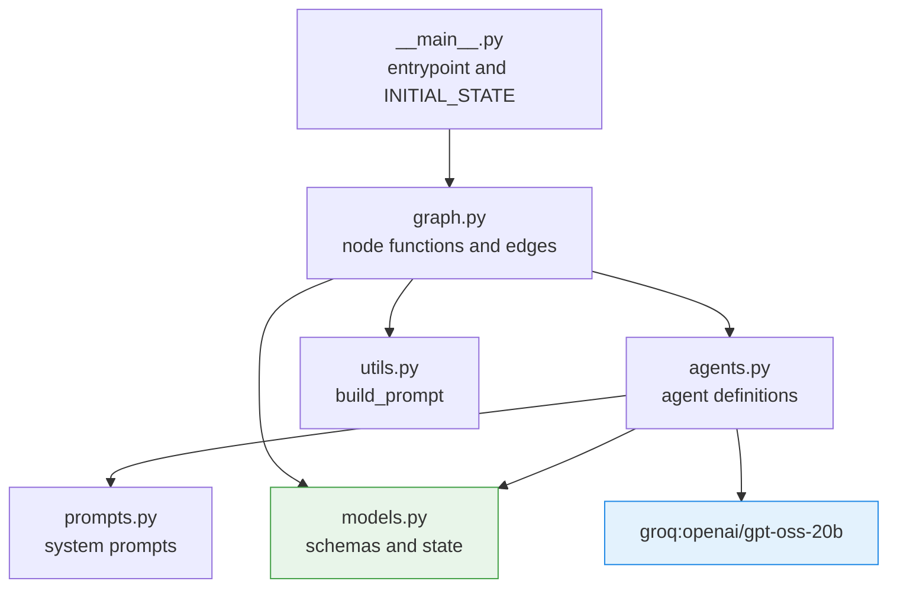

# klyra-prep

AI mock-interview agent. It rewrites a question bank to fit a target role and
experience level, then walks the candidate through it, scoring each answer and
tracking follow-ups.

Built on [LangGraph](https://langchain-ai.github.io/langgraph/) for the
conversation flow and [Pydantic AI](https://ai.pydantic.dev/) for typed model
calls, served by Groq (`openai/gpt-oss-20b`).

## Architecture

Two ideas hold the project together:

1. **A single state object flows through every node.** Nodes are plain
   functions that read the state and return the keys they change. No node
   mutates anything in place, so any node can be run and tested alone.
2. **The schema is the contract.** Each agent declares a Pydantic model as its
   `output_type`. The model is validated before it reaches your code, so a node
   never has to guess what shape a response is in.

### Runtime flow



Solid nodes run today. Dashed nodes are the remaining interview loop. Both
nodes talk to Groq through a Pydantic AI agent and write their result back into
`InterviewConversationState`.

### Module layering



Dependencies point one way only. `models.py` imports nothing from the project,
so the data contract can be read on its own.

| Module | Responsibility |
| --- | --- |
| `__main__.py` | CLI entrypoint, seeded `INITIAL_STATE` |
| `graph.py` | Node functions and the edges between them |
| `agents.py` | One `Agent` per task, plus the shared model config |
| `prompts.py` | System prompts, one constant per agent |
| `utils.py` | `build_prompt`, which renders state into a prompt |
| `models.py` | Pydantic output schemas and `InterviewConversationState` |

### Output handling

Every agent runs with native JSON-schema output rather than tool calls. This is
not a stylistic choice: Pydantic AI defaults to tool calls for this model, and
`gpt-oss` in harmony mode then wraps the payload in its own envelope, renames
fields, and returns lists as plain strings. Groq's JSON Schema Mode returns the
declared schema correctly, so `agents.py` overrides the model profile to force
it. The preparation agent also sets `max_tokens` explicitly, because it writes
an entire question bank in one response and would otherwise hit the default cap
mid-JSON.

## Requirements

- Python 3.12+
- [uv](https://docs.astral.sh/uv/)
- A Groq API key (the free tier is enough)

## Setup

```bash
git clone https://github.com/DarshanPandey515/klyra-prep.git
cd klyra-prep
uv sync
cp .env.example .env      # then paste your GROQ_API_KEY into .env
```

## Usage

```bash
uv run interview-prep              # console script
uv run python -m interview_prep    # equivalent
```

Both invoke the compiled graph once against the seeded state and print the
resulting state, so you can confirm wiring and your API key are working.

## Development

```bash
uv sync                        # install with dev dependencies
uv run ruff check .             # lint
uv run ruff format .            # format
uv add <package>                # add a runtime dependency
uv add --dev <package>          # add a dev dependency
```

## Known issues

Tracked in the code, not yet fixed:

- **`answer_evaluate` output is discarded.** It returns `score`, `strengths`,
  `weaknesses`, `feedback`, `should_follow_up`, and `follow_up_reason`, but
  `InterviewConversationState` has no such keys, so LangGraph drops them. The
  node should append an `AnswerEvaluation` to the state's `evaluations` list
  instead.
- **The evaluation prompt is missing its subject.** It sends all prepared
  questions but not the candidate's answer, and uses `experience=` where the
  state field is `experience_level`.
- **`follow_up_agent()` in `graph.py` is a broken stub.** It indexes
  `state["expec"]`, returns `None`, and shadows the `follow_up_agent` imported
  from `agents.py`. It is not registered as a node, so it does not run yet.
- **Question count is not validated.** The preparation agent occasionally
  returns fewer questions than it was given, and the graph proceeds with a
  partial bank.